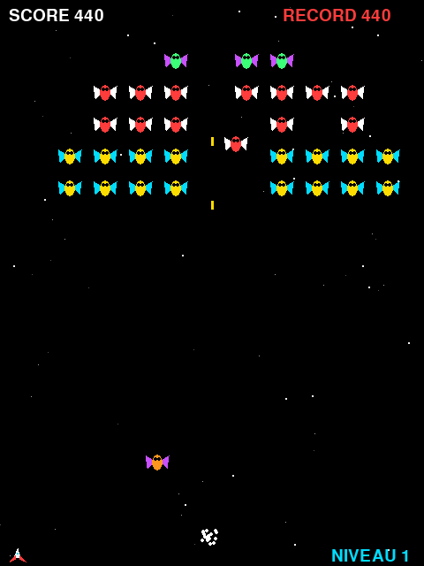

# Space Shooter (Python / pygame)

Petit jeu de tir spatial dans le style des shoot'em up d'arcade : une formation d'ennemis se balance en haut de l'écran et certains plongent en piqué vers le joueur en tirant.



## Installation et lancement

```bash
pip install pygame
python space_shooter.py
```

## Contrôles

| Touche | Action |
|---|---|
| ← → (ou A / D) | Déplacer le vaisseau |
| Espace | Tirer (2 tirs à l'écran maximum) |
| P | Pause |
| Entrée | Commencer / rejouer |
| Échap | Quitter |

## Règles

- 3 types d'ennemis : **boss** (vert, 2 coups), **papillons** (rouges), **abeilles** (jaunes).
- Un ennemi abattu pendant son piqué rapporte plus de points.
- 3 vies ; chaque niveau terminé en lance un plus rapide et plus agressif.
